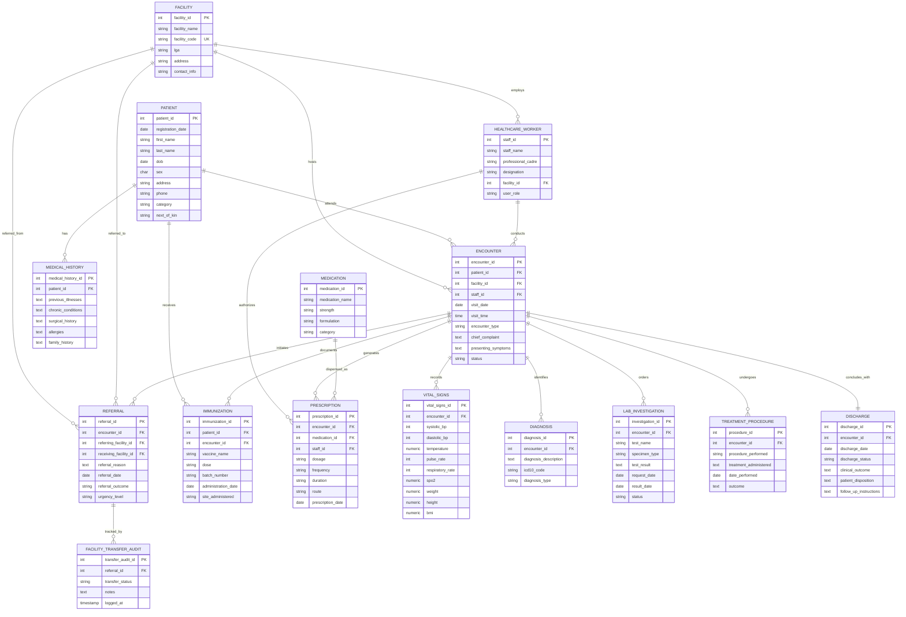

# Portfolio 1: Database Design & Modelling
**Course:** MIT 8103 – Advanced Database Systems  
**Case Study:** Lagos State Primary Health Care Board (LSPHCB) Electronic Medical Records (EMR) System  
**Target RDBMS:** PostgreSQL 16+

---

## 1. Case Study Description & Problem Context

The Lagos State Primary Health Care Board (LSPHCB) oversees primary healthcare delivery across 20 Local Government Areas (LGAs) and 37 Local Council Development Areas (LCDAs). Public Primary Healthcare Centres (PHCs)—ranging from large maternal-child health complexes in Alimosho and Surulere to compact health posts in Badagry and Epe—cater to thousands of outpatients daily. 

In Lagos PHCs, the clinical reality centers on:
- **Maternal and Child Health:** Antenatal Care (ANC), routine childhood immunizations (Pentavalent, BCG, OPV, Measles).
- **Endemic Outpatient Disease Burden:** Malaria (accounting for 50–65% of daily outpatient visits), upper respiratory infections, gastroenteritis, and early hypertension screening.
- **Inter-Facility Mobility:** Patients frequently register at one PHC close to their home (e.g. Ikotun, Alimosho) and later visit a facility near their workplace (e.g. Ikeja or Broad Street, Lagos Island).

### The Real-World Bottleneck
Before a unified database, clinics operated with paper registers (the traditional "Tally Sheet" and bulky physical clinic cards) or disconnected spreadsheets. When a patient arrived:
1. Nurses spent 15 to 30 minutes searching physical paper folders or searching unstandardized local sheets.
2. Chronic illnesses (hypertension) and lethal drug allergies (penicillin anaphylaxis) were routinely missed if the patient forgot their physical card.
3. Epidemiological reporting (e.g., monthly malaria cases or vaccine coverage for Lagos State Ministry of Health) required manual counting from paper ledgers, leading to human error and reporting delays.

---

## 2. From Raw Entities & Attributes to 3NF Normalization

To design a clean relational database, an average SQL developer must understand normalization not as abstract mathematics, but as a practical **cleaning process**:
> *"Each piece of clinical data should live in exactly one place and depend solely on the primary key, the whole key, and nothing but the key."*

Let's walk through how we progressed from raw hospital intake data to **1NF**, **2NF**, and **3NF**.

---

### Step 0: Raw Entities & Attributes (Unnormalized Form - UNF)

In a raw paper ledger or legacy Excel workbook, a nurse at Alimosho PHC records an encounter in a single flat structure.

#### Raw Entity Attributes List:
`PatientID`, `PatientFullName`, `DateOfBirth`, `Gender`, `ResidentialAddress`, `PhoneNumber`, `PatientCategory`, `NextOfKinDetails`, `ChronicIllnesses`, `Allergies`, `FacilityCode`, `FacilityName`, `FacilityLGA`, `FacilityAddress`, `StaffName`, `StaffCadre`, `StaffRole`, `VisitDate`, `VisitTime`, `EncounterType`, `ChiefComplaint`, `Symptoms`, `VitalSignsRecorded`, `DiagnosesGiven`, `LabTestsAndResults`, `PrescribedDrugsAndDosages`, `VaccinesGiven`, `ReferralDetails`, `DischargeSummary`

#### Example Raw Table (UNF):
| PatientID | PatientFullName | ResidentialAddress | VitalsRecorded | DiagnosesGiven | LabTestsAndResults | PrescribedDrugsAndDosages | FacilityName | StaffName |
| :--- | :--- | :--- | :--- | :--- | :--- | :--- | :--- | :--- |
| **P-101** | Adebayo Ogundipe | 14 Iyana Ipaja, Alimosho | BP: 118/76, Temp: 39.2C, Wt: 72kg | Malaria (B54), Typhoid fever (A01.0) | mRDT: Positive; Widal: 1:160 | Artemether/Lumefantrine 80/480mg BD x 3d; Paracetamol 500mg TDS x 3d | Alimosho PHC | Dr. Babatunde Fashola |
| **P-102** | Blessing Okafor | 28 Bode Thomas, Surulere | BP: 110/70, Temp: 36.6C, Wt: 68kg | Normal Pregnancy (Z34.0) | PCV: 33%; Urinalysis: Normal | Folic Acid 5mg Daily x 30d | Surulere Health Centre | Dr. Chioma Okonkwo |

#### Why UNF Fails in Healthcare:
1. **Repeating Groups / Non-Atomic Fields:** Multiple diagnoses, multiple vital sign readings, and multiple medications are crammed into single text columns.
2. **Impossible Querying:** You cannot run `WHERE temperature > 38.0` or calculate average systolic blood pressure because vitals are mixed in a single string `"BP: 118/76, Temp: 39.2C"`.
3. **Data Redundancy:** Every time Adebayo visits the clinic, his address, date of birth, next of kin, clinic name, and LGA are typed all over again.

---

### Step 1: First Normal Form (1NF)

#### 1NF Rules:
1. **Atomic Values:** Every column must contain indivisible, atomic values (one piece of data per cell).
2. **No Repeating Groups:** Multi-valued fields (multiple diagnoses or drugs) must be split into individual rows or distinct tables.
3. **Primary Key:** Each row must have a unique identifier.

#### Transformations Applied:
- `PatientFullName` is decomposed into `first_name` and `last_name`.
- `ResidentialAddress` is structured cleanly.
- `VitalsRecorded` string is broken down into separate physical columns: `systolic_bp INT`, `diastolic_bp INT`, `temperature NUMERIC(4,1)`, `pulse_rate INT`, `weight NUMERIC(5,2)`, `height NUMERIC(5,2)`, `bmi NUMERIC(5,2)`.
- Repeating medications and diagnoses are expanded so that each consultation event has individual rows for each condition and drug prescribed.

#### Intermediate 1NF Schema (Flattened Encounter Rows):
Composite Key: `{PatientID, VisitDate, MedicationName}`

| PatientID (PK) | FirstName | LastName | VisitDate (PK) | FacilityName | LGA | SystolicBP | Temp | DiagnosisCode | MedicationName (PK) | Dosage | Frequency |
| :--- | :--- | :--- | :--- | :--- | :--- | :--- | :--- | :--- | :--- | :--- | :--- |
| 1 | Adebayo | Ogundipe | 2024-02-10 | Alimosho PHC | Alimosho | 118 | 39.2 | B54 | Artemether/Lumefantrine | 80/480mg | Twice daily |
| 1 | Adebayo | Ogundipe | 2024-02-10 | Alimosho PHC | Alimosho | 118 | 39.2 | B54 | Paracetamol | 500mg | Three times daily |
| 2 | Blessing | Okafor | 2024-02-15 | Surulere PHC | Surulere | 110 | 36.6 | Z34.0 | Folic Acid | 5mg | Once daily |

#### Remaining Flaws in 1NF:
- **Massive Partial Dependencies:** If Adebayo receives 3 medications on the same day, his name, date of birth, blood pressure, and clinic LGA are duplicated 3 times on disk.
- If a patient hasn't received any medication yet, can we store their registration? In a composite key `{PatientID, VisitDate, MedicationName}`, `MedicationName` cannot be `NULL`, so we cannot record a patient until a drug is prescribed!

---

### Step 2: Second Normal Form (2NF)

#### 2NF Rules:
1. Must already be in **1NF**.
2. **No Partial Functional Dependencies:** Every non-key attribute must depend on the **entire** candidate key, not just part of it.

#### Identifying the Partial Dependencies in 1NF:
- In the composite key `{PatientID, VisitDate, MedicationName}`:
  - `first_name`, `last_name`, `dob`, `phone` depend **ONLY** on `PatientID` (Part of the key!).
  - `facility_name`, `lga` depend on the facility where the visit occurred.
  - `systolic_bp`, `temperature`, `chief_complaint` depend on the specific `{PatientID, VisitDate}` visit, not on the `MedicationName`.
  - Only `dosage`, `frequency`, and `duration` depend on the specific `{Encounter, Medication}` combination.

#### Transformations Applied (Splitting Entities by Candidate Key):
We eliminate partial dependencies by breaking the flat 1NF table into distinct functional tables with single surrogate primary keys (`SERIAL PRIMARY KEY`):

1. **`patient` Table:** Key is `patient_id`.  
   Attributes: `first_name`, `last_name`, `dob`, `sex`, `address`, `phone`, `category`, `next_of_kin`.  
   *(All attributes depend entirely on `patient_id`).*

2. **`encounter` Table:** Key is `encounter_id`.  
   Attributes: `patient_id (FK)`, `facility_id (FK)`, `staff_id (FK)`, `visit_date`, `visit_time`, `chief_complaint`, `presenting_symptoms`.  
   *(All attributes depend entirely on the encounter visit).*

3. **`vital_signs` Table:** Key is `vital_signs_id`.  
   Attributes: `encounter_id (FK)`, `systolic_bp`, `diastolic_bp`, `temperature`, `pulse_rate`, `weight`, `height`, `bmi`.

4. **`prescription` Table:** Key is `prescription_id`.  
   Attributes: `encounter_id (FK)`, `medication_name`, `strength`, `formulation`, `dosage`, `frequency`, `duration`.

#### Remaining Flaws in 2NF:
Even though partial dependencies are removed, we still have **Transitive Dependencies**!
Look closely at the `prescription` table in 2NF:
`prescription_id` $\to$ `medication_name` $\to$ `(strength, formulation, category)`
If `medication_name = 'Artemether/Lumefantrine'` and its formulation is `'Tablet'`, that formulation depends on the drug itself, NOT on the prescription ID!

---

### Step 3: Third Normal Form (3NF)

#### 3NF Rules:
1. Must already be in **2NF**.
2. **No Transitive Dependencies:** No non-key attribute should depend on another non-key attribute (i.e. $X \to Y$ and $Y \to Z$ where non-key $Z$ depends on non-key $Y$). Every non-key column must depend *directly and exclusively* on the primary key.

#### Identifying Transitive Dependencies in 2NF:

##### 1. The Medication Formulary Transitive Dependency:
- In `prescription`:  
  `prescription_id (PK)` $\to$ `medication_name` $\to$ `strength, formulation, category`
- **The Real-World Hazard (Update Anomaly):** If Lagos State replaces 500mg Paracetamol tablets with 1g dispersible tablets, an operator would have to update 50,000 historical prescription rows! If one row is missed, the database shows conflicting drug formulations.
- **Resolution:** Extract a dedicated `medication` master table:
  - `medication` (`medication_id PK`, `medication_name`, `strength`, `formulation`, `category`)
  - `prescription` now simply references `medication_id (FK)`.

##### 2. The Facility & Staff Transitive Dependency:
- In `encounter`:  
  `encounter_id (PK)` $\to$ `staff_id` $\to$ `facility_id` $\to$ `facility_name, lga, address`
- **The Real-World Hazard (Deletion & Insertion Anomaly):** If you delete all encounters recorded at a brand-new clinic in Epe, you would accidentally erase the clinic's name and LGA from the database! Furthermore, you couldn't record a newly built PHC until a patient has had an encounter there.
- **Resolution:** Extract dedicated `facility` and `healthcare_worker` tables:
  - `facility` (`facility_id PK`, `facility_name`, `facility_code`, `lga`, `address`, `contact_info`)
  - `healthcare_worker` (`staff_id PK`, `staff_name`, `cadre`, `designation`, `facility_id FK`, `user_role`)
  - `encounter` references `patient_id (FK)`, `facility_id (FK)`, `staff_id (FK)`.

##### 3. The Diagnosis Coding Transitive Dependency:
- In `encounter`:  
  Multiple diagnoses per encounter $\to$ separated into `diagnosis` table referencing standardized ICD-10 codes (`icd10_code`, `diagnosis_description`, `diagnosis_type`).

---

### Normalization Progression Summary Table

| Stage | What It Looks Like | Flaw / Anomaly Solved | Example Lagos PHC Anomaly Prevented |
| :--- | :--- | :--- | :--- |
| **UNF** | 1 big flat spreadsheet row per patient visit with comma-separated lists | Unstructured, non-atomic data | Cannot filter patients with `temperature > 38.5C` because vitals are trapped in text. |
| **1NF** | Atomic columns, but multiple rows per visit with composite key `{PatientID, VisitDate, Drug}` | Solves atomicity, but duplicates patient demographics across every drug | Adebayo's address duplicated 5 times for 5 prescribed medicines; cannot register patient without prescribing drug. |
| **2NF** | Entities split by primary key (`patient`, `encounter`, `prescription`), removing partial dependencies | Non-key fields depend on the whole primary key | Prescription details depend on the visit, but drug strength still lives inside prescription. |
| **3NF** | All transitive dependencies eliminated into master tables (`facility`, `medication`) | Every attribute depends on the key, the whole key, and nothing but the key | Updating a PHC facility address or medication strength is done in **1 row**, propagating everywhere automatically. |

---

## 3. Entity-Relationship (ER) Diagram

Below is the complete 3NF Entity-Relationship diagram illustrating all 14 entities and their cardinalities:



---

## 4. Keys and Referential Integrity Constraints

| Table | Primary Key | Foreign Keys & Actions | Justification |
| :--- | :--- | :--- | :--- |
| `facility` | `facility_id` | None | Base administrative registry |
| `healthcare_worker` | `staff_id` | `facility_id` -> `facility` (`ON DELETE RESTRICT`) | Cannot delete a clinic while active staff work there. |
| `patient` | `patient_id` | None | Master Patient Index |
| `encounter` | `encounter_id` | `patient_id` -> `patient` (`ON DELETE RESTRICT`)<br>`facility_id` -> `facility` (`ON DELETE RESTRICT`)<br>`staff_id` -> `healthcare_worker` (`ON DELETE RESTRICT`) | **Audit Trail:** Clinical governance requires that an encounter can never be deleted accidentally if a patient record is modified. |
| `vital_signs` | `vital_signs_id` | `encounter_id` -> `encounter` (`ON DELETE CASCADE`) | Vitals are clinical measurements of an encounter; if a draft encounter is cancelled, measurements are cleared. |
| `diagnosis` | `diagnosis_id` | `encounter_id` -> `encounter` (`ON DELETE CASCADE`) | Diagnoses belong directly to encounters. |
| `prescription` | `prescription_id` | `encounter_id` -> `encounter` (`ON DELETE CASCADE`)<br>`medication_id` -> `medication` (`ON DELETE RESTRICT`) | Cannot delete a formulary drug while active prescriptions reference it. |
| `referral` | `referral_id` | `encounter_id` -> `encounter`<br>`referring_facility_id` -> `facility`<br>`receiving_facility_id` -> `facility` | Patient referral links referring and receiving centers. |

### Domain & Healthcare Check Constraints
We embedded physical and clinical boundary checks directly in the PostgreSQL DDL:
- `chk_bmi`: Ensures `bmi > 0.0`.
- `chk_systolic_bp` & `chk_diastolic_bp`: Enforces physiological human ranges (`systolic > 40 AND systolic < 300`, `diastolic > 20 AND diastolic < 200`).
- `chk_temperature`: Restricts body temperature between `30.0` and `45.0` Celsius.
- `chk_spo2`: Constrains oxygen saturation between `0.0` and `100.0%`.
- `chk_lab_dates`: Enforces that `result_date >= request_date`.
- `chk_referral_facilities`: Disallows transferring a patient to the exact same facility (`referring_facility_id <> receiving_facility_id`).

---

## 5. Execution Verification

The DDL and Seed scripts are fully tested against PostgreSQL 16:
```bash
# Execute DDL schema
psql -d lsphcb_emr -f portfolio-1-database-design/01_schema.sql

# Execute Seed dataset
psql -d lsphcb_emr -f portfolio-1-database-design/02_seed_data.sql
```
Both execute with 0 errors, populating all 14 clinical and operational tables across Lagos State LGAs (Alimosho, Surulere, Ikeja, Lagos Island, Ikorodu, Mushin, Kosofe, Eti-Osa).
