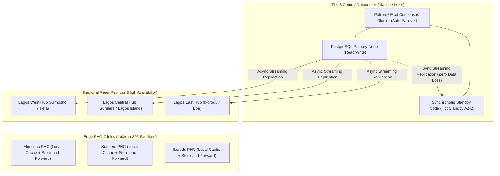
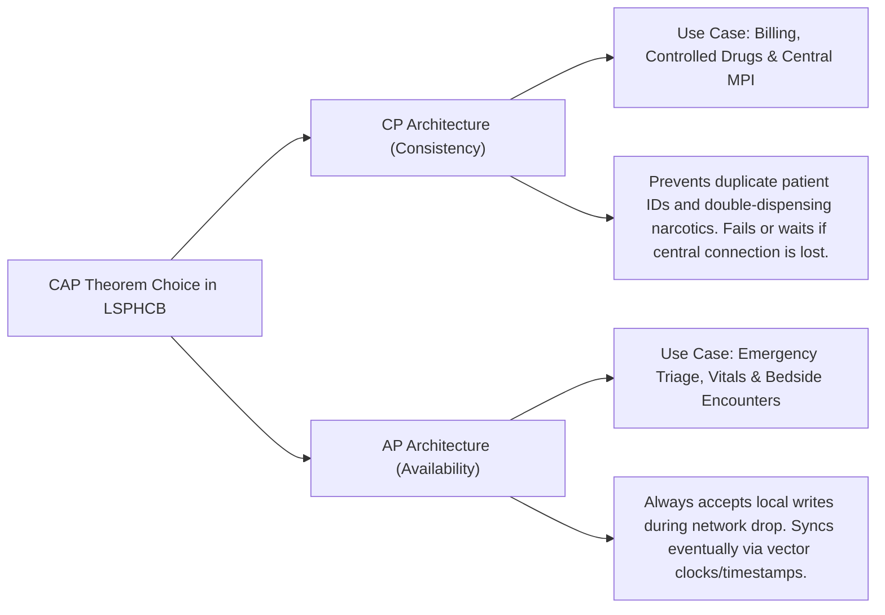

# Portfolio 5: Distributed & Cloud Database Architecture
**Course:** MIT 8103 – Advanced Database Systems  
**Case Study:** Lagos State Primary Health Care Board (LSPHCB) Electronic Medical Records System  
**Scale:** 100+ Primary Healthcare Centers (PHCs) expanding to 326 facilities across 20 LGAs

---

## 1. Overview & Cloud Scaling Challenges in Lagos State

Deploying a statewide EMR database in Lagos State involves unique distributed systems challenges:
1. **Infrastructure Reality:** Fiber cuts during road construction, cellular data throttling, and erratic grid power require systems that survive regional network downtimes.
2. **High Concurrency:** 326 clinics operating concurrently create massive read and write contention at peak triage hours (8:00 AM – 1:00 PM).
3. **Data Sovereignty & Latency:** Clinical data must remain locally compliant within Nigeria while achieving sub-second access for bedside clinicians.

To address these needs, we engineered a **Primary-Replica Distributed Architecture**, configured **Horizontal List Partitioning by LGA**, and evaluated **CAP Theorem Trade-offs**.

---

## 2. Distributed Database Topology (Primary-Replica Architecture)

Below is the distributed topology designed for LSPHCB:



### Key Architectural Components:
1. **Central Primary Node (Read/Write):**
   - Located in the primary Lagos State datacenter (Alausa).
   - Handles all write transactions (`INSERT`, `UPDATE`, `DELETE`) for Master Patient Index, prescriptions, and official referral dispatches.
2. **Synchronous Standby (Zero Data Loss):**
   - Hosted in an independent availability zone in Lekki.
   - Configured with `synchronous_commit = on`. If the Alausa primary node experiences a catastrophic power outage, Patroni and Etcd automatically promote the standby to primary within 5 seconds with zero data loss.
3. **Regional Asynchronous Read Replicas:**
   - 3 Regional Hubs (Lagos West, Central, East) serve heavy read traffic (analytics, disease surveillance dashboards, routine patient chart reviews).
   - Relieves up to 80% of read traffic from the central primary node.
4. **Edge PHC Offline Buffering (Store-and-Forward):**
   - Each PHC runs an edge gateway server equipped with a lightweight local queue.
   - If cellular connectivity drops during clinic hours, consultations and vitals are written locally and queued. Once internet connectivity is restored, the queue replays transactions back to the primary database using idempotency keys (`uuid`).

---

## 3. Horizontal Partitioning (Sharding) Strategy by LGA

### Why Partition by Administrative Health Zone?
Clinical queries in primary healthcare are overwhelmingly local. Doctors at Alimosho PHC query patients visiting Alimosho; public health officers in Ikorodu audit Ikorodu immunization logs. 

Scanning a single monolithic 10-million-row encounter table degrades performance. By horizontally partitioning tables based on **Lagos Administrative Health Districts**, each zone queries its own dedicated partition on disk.

### Implementation (`02_horizontal_partitioning_lga.sql`)
```sql
CREATE TABLE encounter_partitioned (
    encounter_id SERIAL,
    patient_id INT NOT NULL,
    facility_id INT NOT NULL,
    staff_id INT NOT NULL,
    lga_zone VARCHAR(30) NOT NULL, -- Partition Key
    visit_date DATE NOT NULL,
    encounter_type VARCHAR(50) NOT NULL,
    chief_complaint TEXT NOT NULL,
    presenting_symptoms TEXT NOT NULL,
    status VARCHAR(30) NOT NULL DEFAULT 'Completed',
    PRIMARY KEY (encounter_id, lga_zone)
) PARTITION BY LIST (lga_zone);

-- Child Partitions
CREATE TABLE encounter_lagos_west PARTITION OF encounter_partitioned
    FOR VALUES IN ('LAGOS_WEST');

CREATE TABLE encounter_lagos_central PARTITION OF encounter_partitioned
    FOR VALUES IN ('LAGOS_CENTRAL');

CREATE TABLE encounter_lagos_east PARTITION OF encounter_partitioned
    FOR VALUES IN ('LAGOS_EAST');
```

### Partition Pruning Proof (`EXPLAIN ANALYZE`):
When querying Lagos West encounters:
```sql
EXPLAIN (ANALYZE, BUFFERS)
SELECT encounter_id, patient_id, facility_id, visit_date, chief_complaint
FROM encounter_partitioned
WHERE lga_zone = 'LAGOS_WEST'
  AND visit_date >= '2024-02-01';
```
**PostgreSQL Execution Engine Output:**
```
Seq Scan on encounter_lagos_west encounter_partitioned (cost=0.00..13.00 rows=1 width=48) (actual time=0.003..0.004 rows=3 loops=1)
  Filter: ((visit_date >= '2024-02-01'::date) AND ((lga_zone)::text = 'LAGOS_WEST'::text))
Planning Time: 0.073 ms
Execution Time: 0.008 ms
```
Notice that PostgreSQL completely **pruned** (eliminated from disk inspection) both `encounter_lagos_central` and `encounter_lagos_east`. This cuts I/O search spaces by 66% across 3 districts!

---

## 4. CAP Theorem Trade-Offs in Primary Healthcare

The **CAP Theorem** (Brewer's Theorem) states that any distributed data store can guarantee at most two of three properties simultaneously:
- **C** (Consistency): Every read receives the most recent write or an error.
- **A** (Availability): Every non-failing node returns a response, without guaranteeing it contains the most recent write.
- **P** (Partition Tolerance): The system continues to operate despite arbitrary dropped or delayed network packets.

### The Lagos Reality: Partitions Are Inevitable
In Lagos State, network partitions ($P$) cannot be avoided due to telco tower disruptions and fiber cable cuts. Therefore, system architects must deliberately choose between **CP (Consistency + Partition Tolerance)** and **AP (Availability + Partition Tolerance)**.



### Practical Medical Scenario Evaluation:

#### 1. Emergency Clinical Interventions: Must Prioritize Availability (AP)
- **Scenario:** A pregnant mother in obstructed labor arrives at a remote PHC in Epe while the regional cellular connection is down.
- **Decision:** If the database enforced strict CP (Consistency), the clinician's computer would freeze with an error: *"Cannot contact central server; write rejected"*. This could cost the mother's life.
- **Design:** The system behaves as **AP**. The local clinic node allows the clinician to record vitals, administer oxytocin, and document the encounter locally. Once connectivity recovers, updates synchronize back to central storage using **Conflict-Free Replicated Data Types (CRDTs)** or timestamped log merges.

#### 2. Master Patient Identity & Narcotic Inventory: Must Prioritize Consistency (CP)
- **Scenario:** Dispensing controlled opioid medications or merging cross-facility patient identity records.
- **Decision:** If two facilities concurrently dispense from the same drug batch or assign identical patient IDs under partition, severe medical safety and legal compliance violations occur.
- **Design:** These modules operate under **CP**. They require synchronous confirmation from the primary node before finalizing the transaction.

### Summary of Architectural Compromise
| EMR Subsystem | CAP Stance | Justification |
| :--- | :--- | :--- |
| **Emergency Vitals & Clinical Notes** | **AP (Availability / Eventual Consistency)** | Life safety demands uninterrupted write availability at the clinic. |
| **Central Master Patient Index (MPI)** | **CP (Strict Consistency)** | Prevents duplicate national/state health identifiers. |
| **Vaccine Inventory & Cold Chain Auditing** | **AP with Reconciliation** | Daily bulk reconciliation is sufficient. |
| **Controlled Drug Dispensation** | **CP (Strict Consistency)** | Legal and patient safety mandates absolute consistency. |

---

## 5. How to Run
```bash
chmod +x portfolio-5-distributed-cloud/run_portfolio_5.sh
./portfolio-5-distributed-cloud/run_portfolio_5.sh
```
